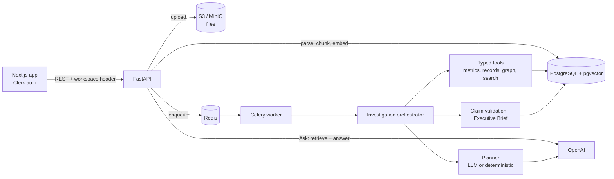

# ORION

**AI executive intelligence for companies.** ORION answers business questions from a
company's own documents and data, and runs bounded, multi-step investigations that
produce evidence-backed Executive Briefs. It says so when the evidence isn't there.


> **Status: v1.0 "ORION Core".** Ask, Investigate, multi-tenant workspaces and the
> ingestion pipeline are implemented and tested. Connectors, proactive alerts and
> approved actions are the v2 roadmap (see [Roadmap](#roadmap)).

## What it does

**Ask.** Upload PDFs, Word documents, CSV, Markdown or text. ORION parses, chunks and
embeds them into pgvector, then answers questions using only retrieved context, with a
source for every answer and explicit uncertainty when the documents don't prove a cause.

**Investigate.** Ask "Why did revenue decline in July?" and ORION:

1. Plans the investigation as typed tool calls, validated against a schema.
2. Runs the tools: metric series, period-over-period change, contribution ranking,
   related records, relationship traversal and semantic document search.
3. Records every result as evidence with provenance (source file, row, document chunk).
4. Builds claims classified as **fact**, **derived** or **hypothesis**, and validates each
   one against its evidence.
5. Writes an Executive Brief: what happened, the primary driver, the likely explanation
   (only if validated), confidence with a rationale, key evidence, open uncertainties and
   follow-up questions.

Every number in a brief comes from a tool result, never from the language model.

## Measured results

From the automated test suite, run in CI against PostgreSQL 16 with pgvector:

| Check | Result |
| --- | --- |
| Automated tests | 65 passing: API flows, ingestion, migrations, tenant isolation, investigation engine, evaluation |
| Revenue investigation on the synthetic demo company | Correctly computed an 18% decline ($500K to $410K) and attributed 88.9% of it to one customer; explanation validated |
| Negative control: same question with the supporting evidence removed | No explanation stated; brief confidence capped at 0.44 |
| Cross-workspace isolation | Every retrieval and investigation tool is tested to reject data from another workspace |

The negative control matters most. An executive tool that invents causes is worse than
no tool at all, so ORION is tested for refusing as well as for answering.

## Architecture



**Design decisions**

- **Bounded agent execution.** Each investigation has hard limits on steps, model calls,
  retrieval calls and runtime. Plans are canonicalized and validated before any tool runs.
- **Durable, idempotent jobs.** Investigations run as Celery tasks with late acks, retry
  with backoff for transient failures, and a Postgres advisory lock so a retried job can't
  run twice. Completed steps are reused on retry.
- **Tenant isolation by construction.** Every persisted table carries `workspace_id`.
  Every query and tool is scoped to it, and tools reject entity IDs from other workspaces.
  A read-only demo workspace sits beside private ones.
- **Idempotent source imports.** Imported items keep a stable source identity and a
  SHA-256 content hash. Re-importing unchanged content is a no-op, and changed content
  is written to a new storage version before the database pointer moves.
- **Migrations you can trust.** Six Alembic migrations, tested against a live Postgres
  for upgrades and preservation of existing data.

## Tech stack

- **Frontend:** Next.js 15, React 19, TypeScript, Tailwind CSS, Clerk
- **Backend:** FastAPI, SQLAlchemy 2 (async), Alembic, Pydantic 2
- **Data:** PostgreSQL 16 + pgvector, Redis, S3-compatible storage (MinIO locally)
- **AI:** OpenAI embeddings and chat models with structured outputs
- **Jobs:** Celery
- **Quality:** pytest, Ruff, ESLint, GitHub Actions

## Project structure

```
admin-ai/
├── apps/
│   ├── web/                 # Next.js frontend
│   └── api/                 # FastAPI backend
│       ├── app/investigations/   # planner, tools, claims, orchestrator, budgets
│       ├── app/services/         # ingestion, parsing, retrieval, RAG, storage
│       └── tests/                # 65 tests incl. migration and evaluation suites
├── workers/celery/          # background investigation worker
├── demo/orion_company/      # synthetic company dataset + expected findings
├── infra/docker-compose.yml # Postgres+pgvector, Redis, MinIO
└── docs/ORION_MASTER_SPEC.md
```

## Prerequisites

- Node.js 20+
- Python 3.11+
- Docker & Docker Compose

## Quick start

### 1. Start infrastructure

```bash
make infra-up
# or: docker compose -f infra/docker-compose.yml up -d
```

Services:
| Service  | URL                    | Credentials        |
|----------|------------------------|--------------------|
| Postgres | localhost:5432         | adminai / adminai  |
| Redis    | localhost:6379         | —                  |
| MinIO    | localhost:9000 (API)   | minioadmin / minioadmin |
| MinIO UI | localhost:9001         | minioadmin / minioadmin |

### 2. Configure environment

```bash
cp apps/web/.env.example apps/web/.env.local
cp apps/api/.env.example apps/api/.env
```

Add your [Clerk](https://dashboard.clerk.com) keys to `apps/web/.env.local`.

### 3. Install dependencies

```bash
make install
```

### 4. Initialize the database schema

For a fresh database:

```bash
make db-upgrade
```

For an existing local database created before Alembic was added, validate and
stamp the document schema before applying additive migrations:

```bash
make db-baseline
make db-upgrade
```

The baseline command refuses to stamp partial or drifted schemas.

### 5. Run the apps

Terminal 1 — API:
```bash
make dev-api
```

Terminal 2 — Worker (required for investigations):
```bash
make dev-worker
```

Terminal 3 — Web:
```bash
make dev
```

- Web: http://localhost:3000
- API: http://localhost:8000
- API docs: http://localhost:8000/docs

## Development

```bash
# Run API tests (start Postgres first with `make infra-up`; migration and
# demo-evaluation tests skip without it, and CI sets ORION_REQUIRE_POSTGRES=1
# so they fail instead of skipping)
cd apps/api && .venv/bin/pytest

# Lint API
cd apps/api && .venv/bin/ruff check app tests

# Lint web
cd apps/web && npm run lint
```


## Roadmap

ORION Core (v1.0) is the foundation. The full product vision is in
[docs/ORION_MASTER_SPEC.md](docs/ORION_MASTER_SPEC.md). Next, in order:

- [ ] Team membership and roles, invites, rate limits, production auth hardening
- [ ] Background ingestion and sync framework (cursors, deletions, revocation)
- [ ] General business-data layer: metric registry and mapped CSV/XLSX/Sheets import
- [ ] Evidence-cited hypothesis generation for any company, with a multi-company eval set
- [ ] Connectors: Google Drive, Gmail, Slack
- [ ] WATCH: proactive signals, alerts and weekly briefings
- [ ] ACT: drafted emails, briefs and tasks, executed only after human approval
- [ ] Executive dashboard and guided onboarding
- [ ] Public deployment

## Known limitations (v1.0)

- Documents are uploaded manually; there are no live connectors yet.
- The investigation engine is evaluated on one synthetic company dataset, and its
  hypothesis stage is currently tailored to revenue investigations.
- Authentication defaults to a local development principal unless `ORION_AUTH_MODE=clerk`.
- Not deployed publicly yet; runs locally with Docker Compose.
